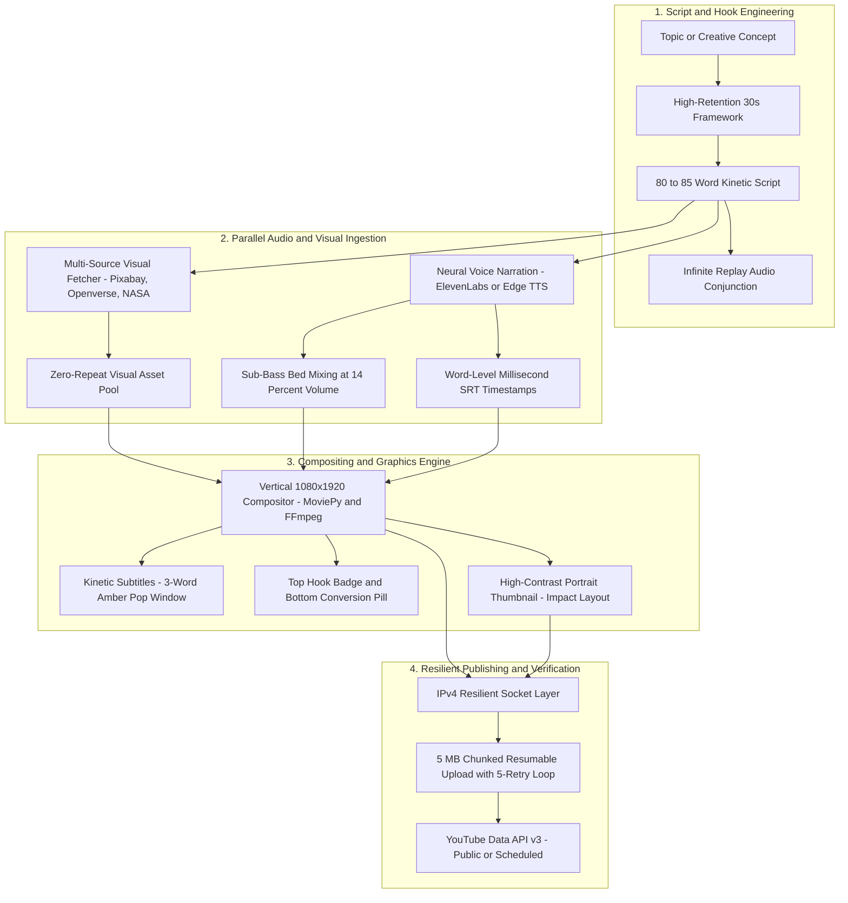

<div align="center">

# 🎬 Tube Trek
### Autonomous Agentic Video Pipeline & YouTube Shorts Studio

[](https://python.org)
[](https://ffmpeg.org)
[](https://elevenlabs.io)
[](https://developers.google.com/youtube/v3)
[](LICENSE)

<br/>

**Tube Trek** is a production-grade, multi-agent AI video studio engineered for high-retention vertical YouTube Shorts (9:16) and long-form explainers. Built with zero-repeat dynamic pacing, synchronized kinetic typography, audio ducking, and fault-tolerant YouTube publishing.

[Core Architecture](#-system-architecture) • [Key Features](#-key-features) • [Quickstart](#-quickstart) • [CLI Usage](#-cli-usage) • [Collaborators](#-collaborators)

</div>

---

## 👥 Core Collaborators & Creators

<div align="center">

| Creator & Lead Architect | Core Engineer & Collaborator |
| :---: | :---: |
| <a href="https://github.com/baerozgaarmard"><br /><sub><b>Ayush Bhatt</b></sub></a><br />[](https://github.com/baerozgaarmard) | <a href="https://github.com/tanisha162"><br /><sub><b>Tanisha Gupta</b></sub></a><br />[](https://github.com/tanisha162) |

</div>

---

## ⚡ System Architecture



```text
┌────────────────────────────────────────────────────────────────────────┐
│ 1. SCRIPT & HOOK   ───►  80-85 Words  ───►  Loop Conjunction Tail      │
└───────────────────────────────────┬────────────────────────────────────┘
                                    │
            ┌───────────────────────┴───────────────────────┐
            ▼                                               ▼
┌──────────────────────────────┐                ┌────────────────────────┐
│ 2A. AUDIO & TIMESTAMPS       │                │ 2B. ZERO-REPEAT B-ROLL │
│ ElevenLabs / Edge-TTS        │                │ Pixabay, Openverse     │
│ Word-Level SRT Sync          │                │ NASA Space Archive     │
└──────────────┬───────────────┘                └───────────┬────────────┘
               │                                            │
               └────────────────────┬───────────────────────┘
                                    │
                                    ▼
┌────────────────────────────────────────────────────────────────────────┐
│ 3. VERTICAL 1080x1920 COMPOSITOR                                       │
│ • MoviePy & FFmpeg libx264 encoding                                    │
│ • 3-Word Centered Kinetic Captions (Amber-Gold Syllable Pop)           │
│ • 0-3s Top Hook Pill Badge + Last 6s Bottom CTA Badge                  │
│ • Custom 9:16 Portrait Thumbnail (Impact Layout)                       │
└───────────────────────────────────┬────────────────────────────────────┘
                                    │
                                    ▼
┌────────────────────────────────────────────────────────────────────────┐
│ 4. RESILIENT YOUTUBE PUBLISHING                                        │
│ • Windows IPv4 Socket Monkey-Patch (Anti-SSL EOF Fault Tolerance)      │
│ • 5 MB Chunked Resumable Upload with 5-Retry Loop                      │
│ • YouTube Data API v3 (Public / Scheduled RFC 3339)                    │
└────────────────────────────────────────────────────────────────────────┘
```

---

## ✨ Key Features

### ⏱️ The 30-Second Retention Engine
- **Target Spoken Length:** Strictly calibrated to **75–85 words (~30–33 seconds)**.
- **Cognitive Hook (0–5s):** Eliminates viewer drop-off within the critical first two seconds using a counter-intuitive paradox accompanied by a top pill badge (e.g., `MICROSCOPIC CHAINSAW`).
- **Infinite Loop Architecture:** The final sentence deliberately terminates on an unfinished conjunction (e.g., *"...tell me below—because..."*) that links seamlessly back to the opening hook when the player auto-loops.

### 🎨 Kinetic Word-Level Subtitles
- Real-time word boundary synchronization down to the millisecond.
- Displays a clean, centered 3-word reading window at 58% eye-line height.
- Highlights the active spoken syllable in **amber-gold**, eliminating visual clutter.

### 🔄 Zero-Loop Dynamic B-Roll Scheduling
- Traditional generators loop the same images repeatedly, driving high swipe rates.
- Tube Trek calculates an adaptive slot duration:
  $$\text{Slot Duration} = \max\left(2.8\text{s}, \min\left(6.0\text{s}, \frac{\text{Total Duration}}{N_{\text{images}}}\right)\right)$$
- Guarantees **every asset appears exactly once**, transitioning smoothly with Ken Burns motion without snapping back.

### 🎙️ Dual Voice Pipeline with Sub-Bass Ducking
- **Primary:** ElevenLabs `George` (`JBFqnCBsd6RMkjVDRZzb`) for deep, authoritative, captivating narration.
- **Keyless Fallback:** Microsoft Edge TTS (`en-US-AndrewNeural`, `en-GB-RyanNeural`) for zero-cost operation.
- **Sound Bed:** Ducked cinematic sub-bass pulse bed (`dark_cosmos_pulse.wav`) at 14%–16% volume.

### 🛡️ Network Resilience & Resumable Uploads
- **Windows IPv4 Monkey-Patch:** Automatically forces `AF_INET` socket resolution to prevent sporadic Windows IPv6 SSL EOF crashes.
- **5-Retry Chunk Loop:** Uploads video in 5 MB chunks with automatic backoff, preventing connection terminations from ruining video production runs.

---

## 🚀 Quickstart

### 1. Clone & Set Up Virtual Environment

```bash
git clone https://github.com/baerozgaarmard/tube-trek.git
cd tube-trek

# Create and activate virtual environment
python -m venv .venv

# Windows:
.\.venv\Scripts\activate
# Linux/macOS:
source .venv/bin/activate

# Install dependencies
pip install -r requirements.txt
```

### 2. System Prerequisite: FFmpeg
Ensure `ffmpeg` is installed and available in your system `PATH`:
```bash
# Windows (winget):
winget install Gyan.FFmpeg

# macOS (Homebrew):
brew install ffmpeg

# Ubuntu/Debian:
sudo apt-get install ffmpeg
```

### 3. Configure API Credentials
Copy the environment template:
```bash
cp .env.example .env
```
Populate your keys in `.env`:
```ini
# Core LLM (Google AI Studio)
GEMINI_API_KEY=your_gemini_api_key

# Stock Imagery
PIXABAY_API_KEY=your_pixabay_api_key
PEXELS_API_KEY=your_pexels_api_key

# Voiceover Engine: "edge-tts" or "elevenlabs"
VOICE_ENGINE=edge-tts
ELEVENLABS_API_KEY=your_elevenlabs_key

# YouTube OAuth (Place client_secret.json in project root)
YOUTUBE_CHANNEL_ID=your_channel_id
```

---

## 💻 CLI Usage

### Generate and Publish a Viral Short in One Command
```bash
python make_short.py --topic "Why Paper Cuts Hurt More Than A Knife" --upload
```

### Render from a Pre-Written Script File
```bash
python make_short.py --script output/custom_script.json --upload
```

### High-Production Mode with ElevenLabs Voice & Scheduled Release
```bash
python make_short.py \
  --topic "Inside A Black Hole You Watch The Universe Die" \
  --voice elevenlabs \
  --upload \
  --schedule "2026-11-15T05:00:00Z"
```

### Options Reference:
- `--topic`: Video concept or title.
- `--script`: Path to pre-generated JSON script.
- `--voice`: Voice engine (`elevenlabs` or `edge-tts`).
- `--music-volume`: Background music volume (default: `0.14`).
- `--upload`: Flags the script to publish to YouTube upon render completion.
- `--privacy`: YouTube privacy status (`public`, `private`, `unlisted`).
- `--schedule`: RFC 3339 timestamp for scheduled release.
- `--thumb-text`: Custom headline for the 9:16 portrait thumbnail.

---

## 📊 Benchmark: Tube Trek vs Standard AI Generators

| Capability | Standard AI Video Tools | Tube Trek Engine |
| :--- | :---: | :---: |
| **Duration Constraint** | Unpredictable (45s–90s) | Strictly 30–33s (Maximum APV) |
| **Visual Looping** | Loops same 3–4 images | Zero-loop heuristic (100% unique visuals) |
| **Kinetic Captions** | Static centered blocks | 3-word centered window with active amber pop |
| **Replay Loop** | Abrupt end | Infinite conjunction sentence loop |
| **Audio Balancing** | Music often drowns voice | Automated 14% dynamic ducking |
| **Publishing Resilience** | Fails on network drop | Chunked 5-retry resumable engine |

---

## 🤖 Agent Integration (Claude Code & Cursor)

Tube Trek includes first-class manifests for AI coding assistants:
- **`CLAUDE.md`**: Instant operational context for **Claude Code**.
- **`.cursorrules`**: Pre-configured directives for **Cursor IDE**.

When opening this repo in Claude or Cursor, simply ask:
> *"Create a Short about the Fermi Paradox and schedule it for 5 PM."*

The agent will execute the exact high-retention pipeline with zero manual setup.

---

## 🔒 License & Intellectual Property

**Proprietary and Confidential.** All Rights Reserved.  
Copyright (c) 2026 **Ayush Bhatt** and **Tanisha Gupta**.

This repository is **Closed Source**. No license or right is granted to copy, distribute, modify, reverse-engineer, or commercially exploit this software without express written permission from the authors. See [LICENSE](LICENSE) for full legal terms.

---

<div align="center">
<sub>Engineered with precision by <a href="https://github.com/baerozgaarmard">@baerozgaarmard</a> and <a href="https://github.com/tanisha162">@tanisha162</a></sub>
</div>
