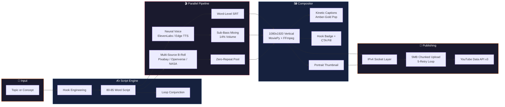

<div align="center">


<br/>

<p>
<a href="https://github.com/baerozgaarmard/tube-trek/releases/latest"></a>&nbsp;
<a href="https://python.org"></a>&nbsp;
<a href="https://ffmpeg.org"></a>&nbsp;
<a href="https://elevenlabs.io"></a>&nbsp;
<a href="https://developers.google.com/youtube/v3"></a>&nbsp;
<a href="LICENSE"></a>
</p>

<br/>

<table>
<tr>
<td width="600">

**Production-grade multi-agent AI studio** that autonomously produces high-retention YouTube Shorts — from topic ideation to published video — in a single command.

Zero-repeat dynamic B-roll · Kinetic word-level captions · Sub-bass audio ducking · Fault-tolerant resumable uploads

</td>
</tr>
</table>

<br/>

[Architecture](#-system-architecture) · [Features](#-key-features) · [Quickstart](#-quickstart) · [CLI](#-cli-usage) · [Benchmark](#-benchmark) · [License](#-license--ip)

<br/>

</div>

<!-- ━━━━━━━━━━━━━━━━━━━━━━━━━━━━━━━━━━━━━━━━━━━━━━━━━━━━━━━━━━━━━━━━━━━━ -->

## 🏗️ System Architecture



<details>
<summary><b>📋 ASCII Fallback</b> (click to expand)</summary>

```
  ┌─────────────────┐       ┌──────────────────────────┐
  │  Topic / Concept │──────▶│  Hook + 80-85w Script    │
  └─────────────────┘       │  + Loop Conjunction Tail  │
                            └────────────┬─────────────┘
                     ┌───────────────────┼───────────────────┐
                     ▼                                       ▼
          ┌─────────────────────┐                 ┌─────────────────────┐
          │  AUDIO PIPELINE     │                 │  VISUAL PIPELINE    │
          │  ├─ Neural Voice    │                 │  ├─ Pixabay         │
          │  ├─ Word-Level SRT  │                 │  ├─ Openverse       │
          │  └─ Sub-Bass 14%    │                 │  └─ NASA Archive    │
          └──────────┬──────────┘                 └──────────┬──────────┘
                     └───────────────────┬───────────────────┘
                                         ▼
          ┌──────────────────────────────────────────────────────────┐
          │  COMPOSITOR  ·  1080×1920  ·  MoviePy + FFmpeg          │
          │  ├─ Kinetic 3-Word Captions (Amber-Gold Syllable Pop)   │
          │  ├─ Top Hook Badge  ·  Bottom CTA Pill                  │
          │  └─ 9:16 Portrait Thumbnail (Impact Layout)             │
          └────────────────────────┬─────────────────────────────────┘
                                   ▼
          ┌──────────────────────────────────────────────────────────┐
          │  RESILIENT PUBLISHER  ·  YouTube Data API v3            │
          │  ├─ IPv4 Socket Monkey-Patch (Anti-SSL EOF)             │
          │  ├─ 5 MB Chunked Resumable Upload  ·  5-Retry           │
          │  └─ Public / Scheduled (RFC 3339)                       │
          └──────────────────────────────────────────────────────────┘
```

</details>

---

## ✨ Key Features

<table>
<tr>
<td width="50%" valign="top">

### ⏱️ 30-Second Retention Engine
- **75–85 words** calibrated for maximum Average Percentage Viewed
- **Cognitive Hook (0–5s)** — counter-intuitive paradox with pill badge
- **Infinite Loop** — unfinished conjunction links to opening hook on replay

### 🎨 Kinetic Word-Level Subtitles
- Millisecond word-boundary synchronization
- Clean 3-word reading window at **58% eye-line**
- Active syllable highlighted in **amber-gold**

### 🎙️ Dual Voice + Sub-Bass Ducking
- **Primary:** ElevenLabs `George` — deep, authoritative
- **Fallback:** Edge TTS (`AndrewNeural` / `RyanNeural`) — zero cost
- **Sound Bed:** Cinematic sub-bass at 14%–16% volume

</td>
<td width="50%" valign="top">

### 🔄 Zero-Repeat B-Roll Scheduling
Every asset appears exactly **once** — no visual loops, no repeated frames.

$$\text{Slot} = \max\!\Big(2.8\text{s},\;\min\!\Big(6.0\text{s},\;\frac{\text{Duration}}{N_{\text{images}}}\Big)\Big)$$

Smooth Ken Burns transitions without snapping back.

### 🛡️ Network Resilience
- **IPv4 Monkey-Patch** — forces `AF_INET` to prevent Windows SSL EOF
- **5-Retry Chunk Loop** — 5 MB resumable uploads with automatic backoff

### 🤖 Agent-Native
First-class manifests for AI coding assistants:
- **`CLAUDE.md`** → Claude Code
- **`.cursorrules`** → Cursor IDE

> *"Create a Short about the Fermi Paradox and schedule it for 5 PM."*

</td>
</tr>
</table>

---

## 🚀 Quickstart

### 1 · Clone & Install

```bash
git clone https://github.com/baerozgaarmard/tube-trek.git
cd tube-trek
python -m venv .venv && .venv\Scripts\activate   # Windows
pip install -r requirements.txt
```

### 2 · FFmpeg

```bash
winget install Gyan.FFmpeg          # Windows
brew install ffmpeg                 # macOS
sudo apt install ffmpeg             # Ubuntu/Debian
```

### 3 · Configure `.env`

```bash
cp .env.example .env
```

```ini
PIXABAY_API_KEY=your_key            # Stock imagery
PEXELS_API_KEY=your_key
VOICE_ENGINE=edge-tts               # or "elevenlabs"
ELEVENLABS_API_KEY=your_key
YOUTUBE_CHANNEL_ID=your_id          # Place client_secret.json in root
```

---

## 💻 CLI Usage

```bash
# Generate + publish in one shot
python make_short.py --topic "Why Paper Cuts Hurt More Than A Knife" --upload

# From a pre-written script
python make_short.py --script output/custom_script.json --upload

# ElevenLabs voice + scheduled release
python make_short.py \
  --topic "Inside A Black Hole You Watch The Universe Die" \
  --voice elevenlabs --upload --schedule "2026-11-15T05:00:00Z"
```

<details>
<summary><b>🔧 All Flags</b></summary>

| Flag | Description | Default |
|:---|:---|:---|
| `--topic` | Video concept or title | — |
| `--script` | Path to pre-generated JSON script | — |
| `--voice` | Engine: `elevenlabs` or `edge-tts` | `edge-tts` |
| `--music-volume` | Background music level | `0.14` |
| `--upload` | Publish to YouTube after render | `false` |
| `--privacy` | `public` · `private` · `unlisted` | `public` |
| `--schedule` | RFC 3339 timestamp for release | — |
| `--thumb-text` | Custom thumbnail headline | — |

</details>

---

## 📊 Benchmark

<table>
<tr>
<th width="30%">Capability</th>
<th width="35%">Standard AI Video Tools</th>
<th width="35%">Tube Trek</th>
</tr>
<tr><td><b>Duration Control</b></td><td>❌ Unpredictable 45s–90s</td><td>✅ Strictly 30–33s</td></tr>
<tr><td><b>Visual Looping</b></td><td>❌ Same 3–4 images repeat</td><td>✅ Zero-loop — 100% unique</td></tr>
<tr><td><b>Kinetic Captions</b></td><td>❌ Static centered blocks</td><td>✅ 3-word amber pop window</td></tr>
<tr><td><b>Replay Hook</b></td><td>❌ Abrupt ending</td><td>✅ Infinite conjunction loop</td></tr>
<tr><td><b>Audio Balance</b></td><td>❌ Music drowns voice</td><td>✅ 14% dynamic ducking</td></tr>
<tr><td><b>Upload Resilience</b></td><td>❌ Fails on network drop</td><td>✅ Chunked 5-retry engine</td></tr>
</table>

---

## 👥 Collaborators

<div align="center">
<table>
<tr>
<td align="center" width="200">
<a href="https://github.com/baerozgaarmard">
<br/>
<b>Ayush Bhatt</b></a><br/>
<sub>Creator & Lead Architect</sub><br/>
<a href="https://github.com/baerozgaarmard"></a>
</td>
<td align="center" width="200">
<a href="https://github.com/tanisha162">
<br/>
<b>Tanisha Gupta</b></a><br/>
<sub>Core Engineer & Collaborator</sub><br/>
<a href="https://github.com/tanisha162"></a>
</td>
</tr>
</table>
</div>

---

## 🔒 License & IP

**Proprietary and Confidential.** All Rights Reserved.
Copyright © 2026 **Ayush Bhatt** and **Tanisha Gupta**.

This repository is **Closed Source**. No license or right is granted to copy, distribute, modify, reverse-engineer, or commercially exploit this software without express written permission from the authors. See [LICENSE](LICENSE) for full legal terms.

---

<div align="center">


<sub>Engineered with precision by <a href="https://github.com/baerozgaarmard">@baerozgaarmard</a> and <a href="https://github.com/tanisha162">@tanisha162</a></sub>

</div>
