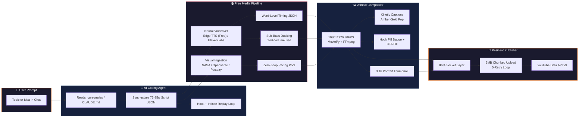
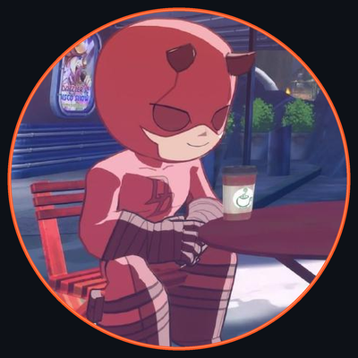
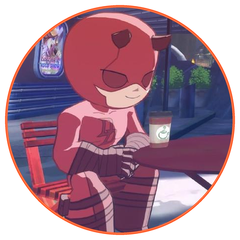
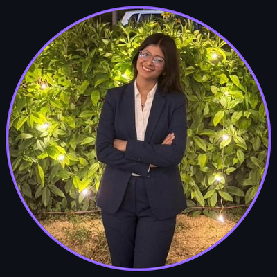

<div align="center">


<br/>

<p>
<a href="https://github.com/baerozgaarmard/tube-trek/releases/latest"></a>&nbsp;
<a href="#-100-free-zero-key-pipeline"></a>&nbsp;
<a href="https://python.org"></a>&nbsp;
<a href="https://ffmpeg.org"></a>&nbsp;
<a href="https://developers.google.com/youtube/v3"></a>&nbsp;
<a href="LICENSE"></a>
</p>

<br/>

<table>
<tr>
<td width="600">

**Autonomous Agent-Native YouTube Shorts Studio** that produces high-retention 9:16 vertical Shorts in a single command.

Zero-repeat dynamic B-roll · Kinetic word-level captions · Sub-bass audio ducking · 100% Free with zero LLM API keys required.

</td>
</tr>
</table>

<br/>

[Free Pipeline](#-100-free-zero-key-pipeline) · [Architecture](#-system-architecture) · [Features](#-key-features) · [Quickstart](#-quickstart) · [Benchmark](#-benchmark) · [License](#-license--ip)

<br/>

</div>

<!-- ━━━━━━━━━━━━━━━━━━━━━━━━━━━━━━━━━━━━━━━━━━━━━━━━━━━━━━━━━━━━━━━━━━━━ -->

## ⚡ 100% Free Zero-Key Pipeline

> [!TIP]
> **No LLM API keys, no browser dashboard, no token bills.**
> You can run Tube Trek completely free with a single install command directly via your AI coding agent (Cursor, Claude Code, Antigravity, Gemini CLI):
> - **Zero LLM API Keys:** Your coding agent authors the viral script directly from its own intelligence.
> - **Zero-Cost Voiceover:** Built-in neural voice synthesis via Microsoft Edge TTS (word-level sync included).
> - **Free Visuals:** Automated B-roll from public domain and CC archives (NASA, Openverse, Pexels).
> - **Local Compositor:** High-speed rendering with MoviePy and FFmpeg on your local machine.

---

## 🏗️ System Architecture



<details>
<summary><b>📋 ASCII Architecture Fallback</b> (click to expand)</summary>

```
  ┌───────────────────────────┐       ┌────────────────────────────────────────┐
  │  User Prompt in Agent UI  │──────▶│  AI Coding Agent (Cursor/Claude Code)  │
  └───────────────────────────┘       │  ├─ 0-5s Paradox Hook                  │
                                      │  ├─ 5-25s Scientific Core              │
                                      │  └─ 25-30s Infinite Replay Conjunction │
                                      └───────────────────┬────────────────────┘
                               ┌──────────────────────────┴──────────────────────────┐
                               ▼                                                     ▼
                  ┌─────────────────────────┐                           ┌─────────────────────────┐
                  │   AUDIO ENGINE          │                           │   VISUAL ENGINE         │
                  │   ├─ Neural Edge TTS    │                           │   ├─ Pexels / Pixabay   │
                  │   ├─ Word-Level Timing  │                           │   ├─ NASA Public Media  │
                  │   └─ Sub-Bass 14% Duck  │                           │   └─ Zero-Loop Pool     │
                  └────────────┬────────────┘                           └────────────┬────────────┘
                               └──────────────────────────┬──────────────────────────┘
                                                          ▼
                               ┌─────────────────────────────────────────────────────┐
                               │  VERTICAL COMPOSITOR  ·  1080×1920 (MoviePy/FFmpeg) │
                               │  ├─ Kinetic 3-Word Captions (Amber-Gold Word Pop)   │
                               │  ├─ Top Hook Pill Badge  ·  Bottom CTA Pill         │
                               │  └─ 9:16 Portrait Thumbnail (Impact Layout)         │
                               └──────────────────────────┬──────────────────────────┘
                                                          ▼
                               ┌─────────────────────────────────────────────────────┐
                               │  PUBLISHER  ·  YouTube Data API v3 (Optional)       │
                               │  ├─ IPv4 Anti-Timeout Layer  ·  5-Retry Loop        │
                               │  └─ Resumable 5 MB Chunks  ·  Scheduled / Public   │
                               └─────────────────────────────────────────────────────┘
```

</details>

---

## ✨ Key Features

<table>
<tr>
<td width="50%" valign="top">

### ⏱️ 30-Second Retention Engine
- **75–85 words** calibrated for maximum Average Percentage Viewed (APV)
- **Cognitive Hook (0–5s)** — counter-intuitive paradox with pill badge
- **Infinite Loop (25–30s)** — unfinished conjunction links directly to opening hook on replay

### 🎨 Kinetic Word-Level Subtitles
- Millisecond word-boundary synchronization
- Clean 3-word reading window at **58% eye-line**
- Active spoken word highlighted in **amber-gold**

### 🎙️ Neural Voice + Sub-Bass Ducking
- **Default:** Free neural Edge TTS (`en-US-AndrewNeural` / `en-GB-RyanNeural`) — zero cost, zero keys
- **Optional:** ElevenLabs (`George` / `Alice`)
- **Sound Bed:** Cinematic tension sub-bass dynamically ducked to **14% volume**

</td>
<td width="50%" valign="top">

### 🔄 Zero-Repeat B-Roll Scheduling
Every asset appears exactly **once** — no visual loops, no repeated frames.

$$\text{Slot} = \max\!\Big(2.8\text{s},\;\min\!\Big(6.0\text{s},\;\frac{\text{Duration}}{N_{\text{images}}}\Big)\Big)$$

Smooth Ken Burns transitions without snapping back.

### 🛡️ Network Resilience
- **IPv4 Monkey-Patch** — forces `AF_INET` to prevent Windows SSL EOF
- **5-Retry Chunk Loop** — 5 MB resumable uploads with automatic backoff

### 🤖 100% Agent-Native
First-class manifests for AI coding assistants:
- **`CLAUDE.md`** → Claude Code
- **`.cursorrules`** → Cursor IDE

> *"Create a Short about the Fermi Paradox and publish it."*

</td>
</tr>
</table>

---

## 🚀 Quickstart

### 1 · One-Command Install

```bash
git clone https://github.com/baerozgaarmard/tube-trek.git
cd tube-trek
pip install -r requirements.txt
```

### 2 · Ensure FFmpeg is Installed

```bash
winget install Gyan.FFmpeg          # Windows
brew install ffmpeg                 # macOS
sudo apt install ffmpeg             # Ubuntu/Debian
```

### 3 · Command Your AI Agent Directly (Zero Setup)

You don't need any LLM API keys. Simply open your project in Cursor, Claude Code, or Antigravity and prompt:

> *"Create a YouTube Short about why paper cuts hurt more than knife cuts"*

Your coding agent will draft `script.json` and execute:

```bash
# Preview / render locally:
python make_short.py --script script.json

# Render and publish immediately:
python make_short.py --script script.json --upload
```

*(Optional: If you want automated stock image downloads and direct YouTube uploads, add your free Pexels key to `.env` and place your `client_secret.json` in the root).*

---

## 💻 CLI Usage

```bash
# 1. From an agent-authored script:
python make_short.py --script script.json

# 2. Render and publish directly to YouTube:
python make_short.py --script script.json --upload

# 3. ElevenLabs voice + scheduled release:
python make_short.py \
  --script script.json \
  --voice elevenlabs --upload --schedule "2026-11-16T12:00:00Z"

# 4. Instant standalone render from topic (uses built-in viral template):
python make_short.py --topic "Why Paper Cuts Hurt More Than A Knife"
```

<details>
<summary><b>🔧 All Flags</b></summary>

| Flag | Description | Default |
|:---|:---|:---|
| `--script` | Path to custom agent-authored `script.json` | — |
| `--topic` | Topic title (uses built-in high-retention template) | — |
| `--voice` | Voice engine: `edge-tts` (free) or `elevenlabs` | `edge-tts` |
| `--music-volume` | Background music volume level | `0.14` |
| `--upload` | Publish to YouTube via Data API v3 | `false` |
| `--privacy` | `public` · `private` · `unlisted` | `public` |
| `--schedule` | RFC 3339 timestamp for future release | — |
| `--thumb-text` | Custom thumbnail headline text | — |

</details>

---

## 📊 Benchmark

<table>
<tr>
<th width="30%">Capability</th>
<th width="35%">Standard AI Video Tools</th>
<th width="35%">Tube Trek</th>
</tr>
<tr><td><b>Cost & Setup</b></td><td>❌ Requires paid LLM API keys & web login</td><td>✅ <b>100% Free · Zero API Keys Needed</b></td></tr>
<tr><td><b>Workflow</b></td><td>❌ Click buttons in browser dashboard</td><td>✅ <b>One prompt to your AI coding agent</b></td></tr>
<tr><td><b>Duration Control</b></td><td>❌ Unpredictable 45s–90s</td><td>✅ <b>Strictly 30–33s</b> (High APV)</td></tr>
<tr><td><b>Visual Looping</b></td><td>❌ Same 3–4 images repeat</td><td>✅ <b>Zero-loop — 100% unique shots</b></td></tr>
<tr><td><b>Kinetic Captions</b></td><td>❌ Static centered text blocks</td><td>✅ <b>3-word amber pop window</b></td></tr>
<tr><td><b>Replay Hook</b></td><td>❌ Abrupt ending</td><td>✅ <b>Infinite conjunction loop</b></td></tr>
<tr><td><b>Audio Balance</b></td><td>❌ Music drowns voice</td><td>✅ <b>14% dynamic sub-bass ducking</b></td></tr>
<tr><td><b>Upload Resilience</b></td><td>❌ Fails on network drop</td><td>✅ <b>Chunked 5-retry resumable engine</b></td></tr>
</table>

---

## 👥 Core Engineering & Architecture

<div align="center">

<p align="center">
  <b>The minds behind Tube Trek's zero-cost autonomous video engine.</b><br/>
  <i>Engineered for cinematic 9:16 Shorts with sub-bass audio ducking and kinetic typography.</i>
</p>

<br/>

<table>
<tr>
<td align="center" width="390" valign="top">
<br/>
<a href="https://github.com/baerozgaarmard">
  
  
</a>
<br/><br/>
<a href="https://github.com/baerozgaarmard">
  <b><font size="+2">Ayush Bhatt</font></b>
</a>
<br/><br/>
<a href="https://github.com/baerozgaarmard">
  
</a>
<br/><br/>
<p align="center">
  <i>"Full-stack dev shipping websites, Android apps & AI agents at BrandForge Media."</i><br/>
  📍 <b>Dehradun, India</b>
</p>
<br/>
<b>Core Focus & Modules</b><br/>
<kbd>🎬 Compositor Engine</kbd> <kbd>🤖 Agentic Pipeline</kbd><br/>
<kbd>⚡ Zero-Key Engine</kbd> <kbd>📦 CI/CD & Packages</kbd>
<br/><br/>
<b>Connect & Follow</b><br/>
<a href="https://github.com/baerozgaarmard">
  
</a>
<br/><br/>
<a href="https://github.com/baerozgaarmard">
  
</a>&nbsp;
<a href="https://brandforge-media.vercel.app/">
  
</a>&nbsp;
<a href="https://twitter.com/baerozgaarmard">
  
</a>
<br/><br/>
</td>

<td align="center" width="390" valign="top">
<br/>
<a href="https://github.com/tanisha162">
  
  
</a>
<br/><br/>
<a href="https://github.com/tanisha162">
  <b><font size="+2">Tanisha Gupta</font></b>
</a>
<br/><br/>
<a href="https://github.com/tanisha162">
  
</a>
<br/><br/>
<p align="center">
  <i>"Full-Stack & AI/ML Engineer | Building RAG & Agentic Systems | B.Tech CSE Jaypee '27"</i><br/>
  ⚡ <b>500+ DSA @ LeetCode</b>
</p>
<br/>
<b>Core Focus & Modules</b><br/>
<kbd>🔊 Dynamic Sub-Bass Ducking</kbd> <kbd>✨ Kinetic Captions</kbd><br/>
<kbd>🧠 Multi-Engine QA</kbd> <kbd>🔄 Infinite Loop Hooks</kbd>
<br/><br/>
<b>Connect & Follow</b><br/>
<a href="https://github.com/tanisha162">
  
</a>
<br/><br/>
<a href="https://github.com/tanisha162">
  
</a>&nbsp;
<a href="mailto:gtanisha162@gmail.com">
  
</a>&nbsp;
<a href="https://github.com/baerozgaarmard/tube-trek/commits?author=tanisha162">
  
</a>
<br/><br/>
</td>
</tr>
</table>

<br/>

</div>

---

## 🔒 License & IP

**Proprietary and Confidential.** All Rights Reserved.  
Copyright © 2026 **Ayush Bhatt** and **Tanisha Gupta**.

This repository is **Closed Source**. No license or right is granted to copy, distribute, modify, reverse-engineer, or commercially exploit this software without express written permission from the authors. See [LICENSE](LICENSE) for full legal terms.

---

<div align="center">


<sub>Engineered with precision by <a href="https://github.com/baerozgaarmard">@baerozgaarmard</a> and <a href="https://github.com/tanisha162">@tanisha162</a></sub>

</div>
